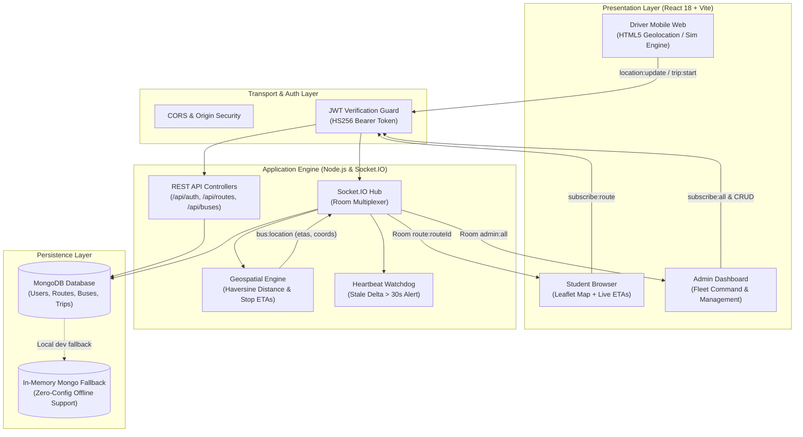

# 🚌 Campus Bus Tracking System

[](.github/workflows/ci.yml)
[](https://nodejs.org/)
[](https://react.dev/)
[](https://vitejs.dev/)
[](https://socket.io/)
[](https://www.oracle.com/java/)
[](https://spring.io/projects/spring-boot)
[](https://leafletjs.com/)
[](LICENSE)

A production-grade, real-time college bus telemetry and fleet management platform engineered for **MGM College of Engineering and Pharmaceutical Sciences, Valanchery**.

Students monitor **live bus positions**, interactive **two-way station tables** (Inbound to College & Outbound to Origin), and **per-stop dynamic ETAs** along actual road polylines. Drivers stream live GPS from their mobile browsers or run deterministic route simulations. Administrators supervise the entire fleet in real time from a centralized dispatch console.

Featuring a **polyglot dual-backend** (Node.js/Socket.IO real-time engine + enterprise Java 17 / Spring Boot 3.2 JPA/JDBC backend) and zero-cost, zero-hardware reliance.

---

## 📑 Table of Contents

- [Key Value Propositions](#-key-value-propositions)
- [Feature Matrix by Persona](#-feature-matrix-by-persona)
- [System Architecture](#-system-architecture)
- [Dual-Backend Engineering](#-dual-backend-engineering)
- [Repository Structure](#-repository-structure)
- [Pre-Seeded Accounts (MGM College Fleet)](#-pre-seeded-accounts-mgm-college-fleet)
- [Quick Start Guide](#-quick-start-guide)
  - [Prerequisites](#prerequisites)
  - [1. Backend Setup (Node.js + Socket.IO)](#1-backend-setup-nodejs--socketio-recommended)
  - [2. Alternative Backend Setup (Java Spring Boot)](#2-alternative-backend-setup-java-spring-boot)
  - [3. Frontend Setup (React 18 + Vite)](#3-frontend-setup-react-18--vite)
- [API & WebSocket Event Contracts](#-api--websocket-event-contracts)
- [Testing & Quality Assurance](#-testing--quality-assurance)
- [Production Cloud Deployment](#-production-cloud-deployment)
- [Documentation Index & Technical Viva Guide](#-documentation-index--technical-viva-guide)

---

## 💡 Key Value Propositions

1. **Zero Hardware Ingestion Cost:** Turns any driver’s smartphone into a high-precision GPS telemetry transponder via the HTML5 Geolocation API (`navigator.geolocation`). No expensive \$300 OBD-II black boxes or proprietary CAN bus wiring required.
2. **Zero Map API Cost:** Powered by **Leaflet.js** and open-source **OpenStreetMap** tile layers. Completely bypasses Google Maps Platform billing paywalls and client-side API key vulnerabilities.
3. **Sub-Second Full-Duplex Telemetry:** Uses persistent **WebSockets (Socket.IO)** with room-based broadcast isolation (`route:<routeId>`, `admin:all`). Replaces wasteful HTTP polling with 2-to-8 byte binary/text frames.
4. **Geodesic Haversine Math & Predictive ETAs:** Server calculates great-circle distances along highway networks and estimates per-stop arrival times using configurable vehicle speeds (`AVG_BUS_SPEED_KMH`).
5. **Bidirectional Route Logic:** Seamlessly flips route geometry and stop orders for morning pickup (*Town Origin $\to$ MGM College*) and evening drop-off (*MGM College $\to$ Town Origin*).
6. **Autonomous 30-Second Watchdog:** Inactivity detector automatically flags buses as `delayed` if GPS telemetry halts for $>30\text{ s}$ while on an active trip.

---

## 👥 Feature Matrix by Persona

### 🎓 Students
- **Dedicated Route View:** Filter by assigned regional bus route (Perinthalmanna, Edappal, Tirur, Kottakkal, Kuttippuram).
- **Interactive Live Map:** Real-time moving bus marker with radar wave animation and dynamic camera panning.
- **Two-Way Station Status Cards:** Real-time stop progression indicators:
  - `Scheduled`: Stop not yet reached.
  - `Next (<ETA>)`: Approaching next immediate stop.
  - `📍 At Station`: Bus currently within station threshold ($\le 250\text{ m}$).
  - `✓ Passed`: Stop successfully cleared.
  - `🏁 Ended`: Final destination reached.
- **Delay Broadcasts:** Instant toast notifications when a driver reports congestion or when the server detects stale coordinates.

### 🚍 Drivers
- **Mobile-First Cockpit:** Optimized touch UI for mobile browser screens.
- **One-Tap Trip Lifecycle:** Start and terminate trips with automated status emission (`idle` $\leftrightarrow$ `active`).
- **Flexible Geolocation Modes:**
  - **Real GPS:** Hardware GPS tracking using browser geolocation (`enableHighAccuracy: true`).
  - **Route Simulation:** Smooth deterministic parametric traversal along real OSRM road polylines (ideal for classroom demos, tunnels, or lab testing).
- **One-Touch Delay Flagging:** Instantly broadcasts delay alerts with custom reasons to all enrolled students and administrators.
- **Return Trip Mode:** Instant toggle to switch tracking from inbound to outbound return routes.

### 🛠️ Administrators
- **Fleet Command Center:** Live consolidated map displaying all active buses and their instantaneous coordinates simultaneously (`subscribe:all`).
- **Route & Stop Management:** Full CRUD operations for routes, ordered geographic stops, and OSRM highway polylines.
- **Fleet & Driver Assignment:** Link vehicles to specific regional routes and assign authorized driver credentials.
- **Audit Logging & Trip History:** Review historical trip logs and GPS coordinate sequences.

---

## 🏗️ System Architecture



---

## ⚡ Dual-Backend Engineering

The platform supports **two interchangeable backends**, demonstrating both lightweight event-driven and enterprise relational paradigms:

| Architectural Metric | Node.js Core Backend | Java Spring Boot Backend |
| :--- | :--- | :--- |
| **Directory** | `backend/` | `backend-java/` |
| **Runtime / Framework** | Node.js 20+ / Express 4 | Java 17+ / Spring Boot 3.2.5 |
| **Real-Time Protocol** | Native WebSockets via Socket.IO 4 | RESTful location updates (`PUT /location`) |
| **Persistence** | MongoDB 6+ with Mongoose 8 | Spring Data JPA (Hibernate) + Native JDBC |
| **Database Engines** | MongoDB / MongoDB Memory Server | H2 Embedded In-Memory (default) / MySQL |
| **Port** | `http://localhost:4000` | `http://localhost:8080` (H2 GUI: `/h2-console`) |

---

## 📂 Repository Structure

```text
.
├── backend/                       # Node.js + Express + Socket.IO Backend
│   ├── src/
│   │   ├── server.js              # HTTP & WebSocket bootstrap + DB connect
│   │   ├── app.js                 # Express routes & middleware mount
│   │   ├── config.js              # Environment variable bindings
│   │   ├── middleware/            # JWT authentication & role-based guards
│   │   ├── models/                # Mongoose schemas (User, Route, Bus, Trip)
│   │   ├── routes/                # REST endpoints (/auth, /routes, /buses, /trips)
│   │   ├── sockets/               # Socket.IO connection & event handlers
│   │   ├── utils/                 # Haversine distance, ETA calculator & simulator
│   │   └── scripts/               # Auto-seeder with 5 MGM regional routes
│   └── tests/                     # Unit & integration test suites (Jest + Supertest)
│
├── backend-java/                  # Enterprise Java Spring Boot Backend
│   ├── pom.xml                    # Maven dependencies (Spring Web, JPA, H2, MySQL)
│   └── src/main/java/com/campusbus/
│       ├── CampusBusApplication.java # Spring Boot application entry point
│       ├── entity/                # JPA entities (User, Route, Stop, Bus, Trip)
│       ├── repository/            # Spring Data JPA repositories
│       ├── controller/            # REST controllers (/api/auth, /api/routes, /api/buses)
│       └── jdbc/                  # Direct JDBC connector (DatabaseConnection.java)
│
├── frontend/                      # React 18 SPA (Vite + Tailwind CSS + Leaflet)
│   ├── src/
│   │   ├── components/            # Leaflet map, Navbar, ProtectedRoute
│   │   ├── context/               # AuthContext (JWT management & session state)
│   │   ├── hooks/                 # useSocket (Socket.IO client hook)
│   │   ├── pages/
│   │   │   ├── admin/             # Fleet monitor, Route CRUD, Bus CRUD, Drivers
│   │   │   ├── driver/            # Mobile-friendly driver cockpit & simulation
│   │   │   ├── student/           # Live route map & two-way station table
│   │   │   ├── Home.jsx           # Landing page with role-based routing
│   │   │   └── Login.jsx          # Secure authentication interface
│   │   ├── api.js                 # Unified fetch abstraction with JWT headers
│   │   └── config.js              # Base URL configuration
│   └── src/test/                  # Frontend tests (Vitest + React Testing Library)
│
├── docs/                          # Architecture & Presentation Assets
│   ├── HLD.md                     # High-Level Design specification
│   ├── API.md                     # Complete REST & WebSocket API contracts
│   ├── DEMO.md                    # 10-Minute live classroom presentation script
│   └── PRESENTATION_GAMMA.md      # Slide prompts & team presentation script
├── DEEP_TECHNICAL_VIVA_NOTE.md    # Advanced technical note & viva defense guide (local)
└── .github/workflows/ci.yml       # GitHub Actions CI pipeline
```

---

## 🔑 Pre-Seeded Accounts (MGM College Fleet)

Running `npm run seed` in `backend` automatically provisions real regional routes with OpenStreetMap highway geometry and assigned accounts:

| Role | Username / Email | Password | Assigned Route / Bus |
| :--- | :--- | :--- | :--- |
| **Admin** | `admin@mgm.ac.in` | `admin123` | *Fleet Command Console (All Buses)* |
| **Student** | `student@mgm.ac.in` | `student123` | *Live Map & Two-Way Station Tables* |
| **Driver 1** | `pmnabus@mgm.ac.in` | `driver123` | Perinthalmanna - MGM College |
| **Driver 2** | `edappalbus@mgm.ac.in` | `driver123` | Edappal - MGM College |
| **Driver 3** | `tirurbus@mgm.ac.in` | `driver123` | Tirur - MGM College |
| **Driver 4** | `kottakkalbus@mgm.ac.in` | `driver123` | Kottakkal - MGM College |
| **Driver 5** | `kuttippurambus@mgm.ac.in` | `driver123` | Kuttippuram - MGM College |

*(Legacy dev accounts `admin@campus.edu`, `driver@campus.edu`, and `student@campus.edu` remain supported for test suites).*

---

## 🚀 Quick Start Guide

### Prerequisites
- **Node.js** `v20.0.0` or higher
- **MongoDB** (Local instance on `mongodb://127.0.0.1:27017` or free MongoDB Atlas cluster; *automatically falls back to in-memory database if no instance is detected*)
- **Java 17+ & Maven** *(only required if evaluating `backend-java`)*

---

### 1. Backend Setup (Node.js + Socket.IO) [Recommended]

```bash
# Navigate to backend directory
cd backend

# Copy environment variables
cp .env.example .env

# Install dependencies
npm install

# Seed MGM College regional routes, buses, and demo accounts
npm run seed

# Start development server (Port 4000)
npm run dev
```

---

### 2. Alternative Backend Setup (Java Spring Boot)

```bash
# Navigate to Java backend directory
cd backend-java

# Run directly via Maven (Port 8080)
mvn spring-boot:run

# Or run the pre-built standalone JAR
java -jar target/campus-bus-tracker-1.0.0.jar
```
* Interactive H2 Database Browser GUI: `http://localhost:8080/h2-console` (JDBC URL: `jdbc:h2:mem:campus_bus`, User: `sa`, Password: *blank*).

---

### 3. Frontend Setup (React 18 + Vite)

```bash
# Open a new terminal and navigate to frontend directory
cd frontend

# Install dependencies
npm install

# Start Vite development server (Port 5173)
npm run dev
```

Open your browser to: **`http://localhost:5173`**

---

## 📡 API & WebSocket Event Contracts

### REST API Endpoints
All protected endpoints require `Authorization: Bearer <JWT>`.

| Method | Endpoint | Access Role | Description |
| :--- | :--- | :--- | :--- |
| `POST` | `/api/auth/login` | Public | Authenticates credentials and returns JWT token |
| `POST` | `/api/auth/register` | Public | Registers a new student account |
| `GET` | `/api/auth/me` | Authenticated | Fetches profile of current token bearer |
| `GET` | `/api/routes` | Authenticated | Returns all active routes with stops & polylines |
| `POST` | `/api/routes` | `admin` | Creates a new route with ordered stations |
| `GET` | `/api/buses` | Authenticated | Lists all registered buses and current coordinates |
| `POST` | `/api/buses` | `admin` | Registers a bus mapped to a route and driver |
| `GET` | `/api/trips` | `admin` | Retrieves historical trip audit logs |

### Real-Time Socket.IO Protocol
Client handshake: `io(BASE_URL, { auth: { token: '<JWT>' } })`.

```
Client (Driver / Student / Admin)                    Socket.IO Server
      │                                                     │
      ├─── emit('subscribe:route', { routeId }) ───────────>│ (Joins room: route:<id>)
      ├─── emit('trip:start', { busId, isReturn }) ────────>│ (Driver only: status -> active)
      ├─── emit('location:update', { lat, lng, ... }) ─────>│ (Calculates ETAs & checks staleness)
      │                                                     │
      │<── emit('bus:location', { lat, lng, etas }) ────────┤ (Broadcasts to room route:<id>)
      │<── emit('bus:delay', { busId, reason }) ────────────┤ (Broadcasts to room route:<id>)
      │<── emit('bus:status', { busId, status }) ───────────┤ (Broadcasts to room route:<id>)
```

---

## 🧪 Testing & Quality Assurance

The codebase includes full unit and integration test coverage across both frontend and backend layers:

```bash
# Run backend test suite (41 tests - Jest, Supertest, In-memory Mongo)
cd backend
npm test

# Generate backend test coverage report
npm run test:coverage

# Run frontend test suite (10 tests - Vitest, Testing Library)
cd frontend
npm test -- --run
```

### Continuous Integration (CI)
Every commit and pull request to `main` executes automated testing across Node 20 environments via GitHub Actions: [`.github/workflows/ci.yml`](.github/workflows/ci.yml).

---

## 🌐 Production Cloud Deployment

### Backend on Render (Web Service)
1. Create a new **Web Service** on [Render](https://render.com) pointing to this repository.
2. Settings:
   - **Root Directory:** `backend`
   - **Build Command:** `npm install`
   - **Start Command:** `npm start`
3. Environment Variables:
   - `NODE_ENV`: `production`
   - `CLIENT_ORIGIN`: `*` (or your production Vercel frontend URL)
   - `JWT_SECRET`: *(Enter a secure 32+ character random string)*
   - `MONGO_URI`: *(Your MongoDB Atlas connection URI)*

### Frontend on Vercel
1. Create a new **Project** on [Vercel](https://vercel.com) pointing to this repository.
2. Settings:
   - **Framework Preset:** `Vite`
   - **Root Directory:** `frontend`
3. Environment Variables:
   - `VITE_API_BASE`: `https://your-render-backend-url.onrender.com`
4. Client-side routing is handled out-of-the-box via `frontend/vercel.json`.

---

## 📚 Documentation Index & Technical Viva Guide

For in-depth architectural specifications, presentation walkthroughs, and viva preparation:

| Document | Content Summary |
| :--- | :--- |
| **`DEEP_TECHNICAL_VIVA_NOTE.md`** *(Local Viva Prep)* | **Exhaustive Viva Voce Guide**: Mathematical Haversine derivation, networking proofs, concurrency models, security analysis, and model answers to top examiner questions. |
| **[`docs/HLD.md`](docs/HLD.md)** | High-Level Design: C4 system context, ER diagrams, logical layers, sequence diagrams, and non-functional requirements. |
| **[`docs/API.md`](docs/API.md)** | Complete RESTful route specifications and Socket.IO event payloads. |
| **[`docs/DEMO.md`](docs/DEMO.md)** | 10-Minute live demonstration script with multi-window role synchronization. |
| **[`docs/PRESENTATION_GAMMA.md`](docs/PRESENTATION_GAMMA.md)** | Multi-presenter presentation script and slide prompts. |

---

## 📜 License & Academic Coursework Notice

This project was developed for the **Software Engineering Laboratory** coursework at **MGM College of Engineering and Pharmaceutical Sciences, Valanchery**.

Released under the **MIT License**. Free for educational and non-commercial institutional deployment.
